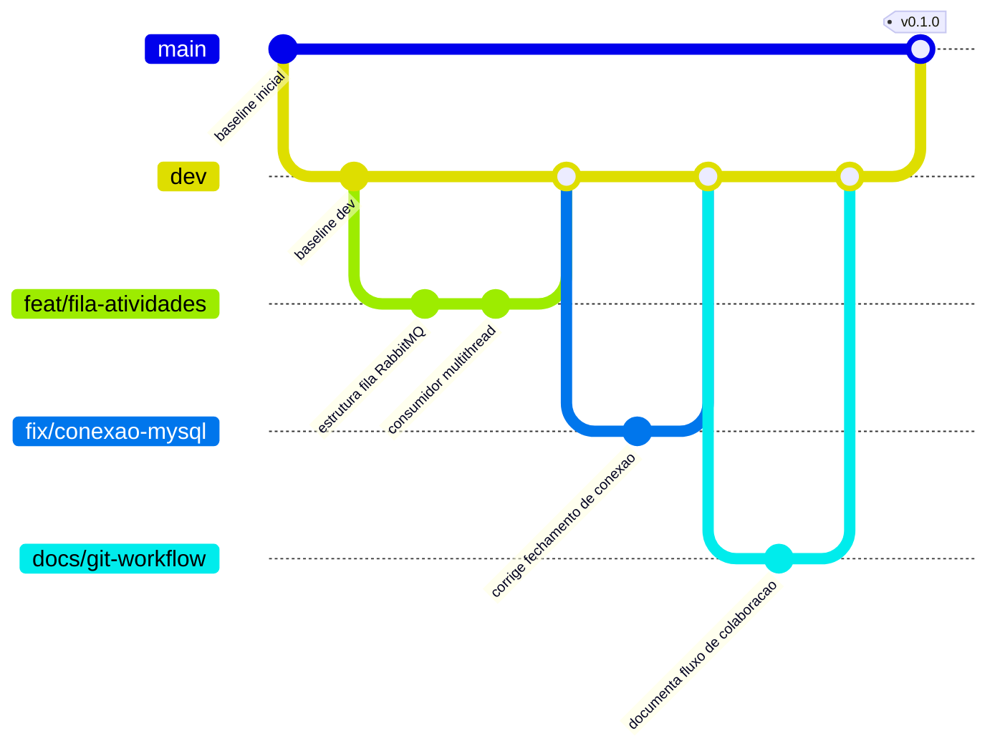

# Fluxo de Git & Guia de Colaboração

Este documento explica como o time do **AjudaNois (Projeto FCCPD)** leva código de uma ideia até a `main`. Foi escrito para todo colaborador — leia antes da sua primeira branch, e releia se o fluxo parecer ambíguo no meio de um PR.

Sempre que o time alterar convenções de branch, validações de PR ou regras de review, atualize *este* documento no mesmo PR — conforme a própria convenção do [`README.md`](../README.md).

---

## 1. Modelo de branches

Três níveis, cada um com um propósito diferente e uma quantidade diferente de cerimônia:

| Branch | Papel | Protegida? | Quem faz merge nela |
| --- | --- | --- | --- |
| `main` | Sempre implantável. Reflete uma entrega ou módulo finalizado e revisado. | Sim — ruleset rígido | Apenas via PR revisado a partir de `dev` |
| `dev` | Branch de integração do módulo atualmente em andamento. | Sim — ruleset mais leve | Apenas via PR revisado a partir de branches `<tipo>/*` |
| `<tipo>/*` | Onde o trabalho de fato acontece. Curta duração, um tópico cada. | Não | N/A — esta é a branch de trabalho |



### Nomenclatura de branch: `<tipo>/<descricao-curta>`

| Tipo | Usar para | Exemplo |
| --- | --- | --- |
| `feat` | Uma nova feature ou capacidade | `feat/fila-atividades` |
| `fix` | Correção de bug | `fix/conexao-mysql` |
| `docs` | Mudanças apenas de documentação | `docs/arquitetura-mensageria` |
| `refactor` | Reestruturação de código sem mudança de comportamento | `refactor/separar-servico-correcao` |
| `test` | Adicionar ou corrigir apenas testes | `test/correcao-atividades` |
| `chore` | Ferramental, dependências, config, Docker, CI | `chore/setup-ci-maven` |
| `style` | Apenas formatação, sem mudança de lógica | `style/padronizar-imports` |

Mantenha a descrição curta, em `kebab-case`, e específica o bastante para que um colega consiga adivinhar o conteúdo só pelo nome. Se o time utilizar GitHub Issues para rastrear tarefas, prefixe com o número da issue: `feat/12-fila-atividades`.

---

## 2. Rulesets de proteção de branch

As regras ficam configuradas em **GitHub repo settings → Rules → Rulesets**, tanto para `main` quanto para `dev`.

### `main` — ruleset rígido (`Protect main`)

- Exigir um pull request antes do merge. Sem pushes diretos, inclusive de admins.
- Exigir ao menos uma aprovação em review (suba para duas se o time decidir aumentar o rigor nas entregas).
- Bloquear force pushes e exclusão da branch.

### `dev` — ruleset mais leve (`Protect dev`)

- Exigir um pull request antes do merge (ninguém dá push direto, nem para consertar algo pequeno — é para isso que existe `fix/*`).
- Exigir ao menos uma aprovação em review.
- Bloquear force pushes e exclusão da branch — raramente há um bom motivo para reescrever o histórico da `dev`.

> O objetivo de proteger a `dev` além da `main` é que um merge ruim na `dev` trava todo mundo que está construindo em cima dela pelo resto da entrega. Proteção não é só para a branch principal — é para a branch da qual o trabalho dos colegas depende.

---

## 3. O ciclo de desenvolvimento, passo a passo

1. **Pegue um pedaço de trabalho.** O ideal é que ele corresponda a uma tarefa combinada pelo time ou a uma issue rastreada no GitHub.
2. **Crie a branch a partir de `dev`, nunca de `main`:**

   ```bash
   git checkout dev
   git pull origin dev
   git checkout -b feat/descricao-curta
   ```

3. **Trabalhe na branch.** Faça commits cedo e com frequência, usando Conventional Commits (§4). Dê push regularmente para que os colegas vejam o progresso e para que você não perca trabalho.
4. **Mantenha a branch atualizada.** Se a `dev` andar enquanto você trabalha, faça rebase (ou merge) dela antes de abrir o PR, para que o review aconteça sobre um diff limpo:

   ```bash
   git fetch origin
   git rebase origin/dev
   ```

5. **Abra um PR para `dev`, não para `main`.** Preencha o template de descrição (§5) e vincule a issue relacionada (ex.: `Closes #12`).
6. **Revise e itere.** Ao menos um colega revisa; responda aos comentários com novos commits (não faça `force-push` no meio do review — isso esconde o que mudou desde a última olhada).
7. **Faça o merge e apague a branch.** Squash-merge é recomendado apenas se o PR tiver vários commits menores/intermediários, para que o histórico da `dev` se leia como um commit por feature em vez de cada `"wip"`. Se não for o caso, siga com o Merge Commit tradicional.
8. **Repita de 2 a 7** para cada feature, correção e mudança de documentação que pertença à entrega ou módulo atual.
9. **Quando o módulo estiver completo, abra um PR de `dev` para `main`.** Este é o review de maior peso — trate-o como um checkpoint, não como formalidade: o sistema realmente compila e funciona ponta a ponta (cliente, servidor, coordenador, RabbitMQ e MySQL), e a documentação reflete a realidade?
10. **Faça o merge na `main`** assim que aprovado em review. Opcionalmente marque o commit de merge com uma tag (`v0.1.0`, `v0.2.0`, ...) para que a fronteira de cada entrega fique visível no histórico do repositório.

---

## 4. Mensagens de commit — Conventional Commits

Formato:

```text
<tipo>(<escopo>): <resumo curto>

<corpo opcional mais longo — o "porquê", não só o "o quê">
```

Use o mesmo vocabulário de `<tipo>` dos prefixos de branch acima (`feat`, `fix`, `docs`, `refactor`, `test`, `chore`, `style`).

O `<escopo>` deve corresponder ao módulo ou área do projeto afetada:

- `entidades` — modelos de domínio em `entidades/`
- `cliente` — aplicação cliente em `cliente/`
- `servidor` — servidor de processamento concorrente em `servidor/`
- `coordenador` — serviço de coordenação e banco de dados em `cordenador-gerenciamento-service/`
- `inscricao` — serviço de inscrição em processo seletivo em `inscricao-processo-seletivo-service/`
- `infra` — `docker-compose.yml`, `dockerfile`, configuração de RabbitMQ/MySQL
- `ci` — workflows em `.github/workflows/`
- `docs` — documentação (`README.md`, `docs/`)
- `repo` — configurações gerais do repositório e `pom.xml` raiz

Exemplos ancorados no domínio deste projeto:

```text
feat(servidor): adiciona processamento concorrente de atividades com pool de threads
fix(coordenador): corrige chamada de repositorio para validar IDs duplicados
docs(docs): documenta fluxo de Git e convencoes de colaboracao
refactor(entidades): unifica classe Atividade no modulo entidades
test(servidor): adiciona testes unitarios para calculo de pontuacao e podio
chore(ci): configura pipeline Maven com Java 21 para PRs em dev e main
chore(infra): ajusta variaveis de ambiente do MySQL no docker-compose
```

Uma boa descrição explica *por que* uma mudança foi feita quando isso não é óbvio pelo diff — `"corrige typo"` basta para um erro de digitação, mas `"adiciona ACK manual no RabbitMQ para evitar perda de atividades se uma thread falhar"` é muito mais útil daqui a alguns meses.

> **Nota sobre idioma:** o histórico deste repositório segue em **português**; mantenha as descrições em português de forma consistente para facilitar a leitura do log. O que **não** deve ser traduzido em nenhum caso são os `<tipo>` (`feat`, `fix`, `docs`, `refactor`, `test`, `chore`, `style`) e os nomes de escopo, pois ferramentas e automações de CI dependem deles.

---

## 5. Diretrizes de pull request

Todo PR — para `dev` ou para `main` — deve responder, seja na descrição ou de forma evidente pelo diff:

- **O quê** isso muda, em uma ou duas frases?
- **Por quê** — qual problema, requisito da disciplina ou issue isso endereça?
- **Como foi testado?** Testes unitários, execução via Docker Compose / passos manuais, ou ambos.
- **Toca alguma decisão registrada na documentação?** Se sim, qual documento, e ele está atualizado neste mesmo PR?

Este repositório já possui o template [`.github/PULL_REQUEST_TEMPLATE.md`](../.github/PULL_REQUEST_TEMPLATE.md), que é preenchido automaticamente ao abrir um PR no GitHub.

---

## 6. Validações automáticas de PR (GitHub Actions)

O workflow em [`.github/workflows/ci.yml`](../.github/workflows/ci.yml) roda automaticamente em todo PR para `dev` e `main` verificando:

- **Convenções de PR (`PR Conventions`)**:
  - Valida que o nome da branch de origem segue `<tipo>/<descricao-curta>` (exceto em PRs de `dev` para `main`).
  - Valida que o título do PR segue Conventional Commits (`<tipo>(<escopo>): <resumo>`).

> O job de build/testes multi-módulo foi removido do workflow para agilizar a integração entre os módulos; antes de solicitar review no PR, recomenda-se rodar localmente os testes do módulo alterado (`mvn -B -pl <modulo> -am test`) e `docker compose config -q`.

---

## 7. Boas práticas

- **Escreva Conventional Commits com uma descrição de verdade.** O público é o seu eu futuro e seus colegas, não o compilador.
- **Atualize a documentação no mesmo PR da mudança** sempre que alterar uma decisão de arquitetura, contrato de fila/mensagem, schema de banco ou fluxo do time — nunca "depois".
- **Use IA para ajudar a escrever testes.** Pedir a um assistente que rascunhe testes unitários para casos extremos (como empate no pódio, concorrência nas threads do servidor ou validação de entidades) é um ótimo uso da ferramenta e evita que cobertura seja deixada de lado.
- **Seja deliberado sobre o quanto a IA escreve por você.** Este projeto existe para que o time aprenda a construir e raciocinar sobre sistemas concorrentes, paralelos e distribuídos — protocolos de mensageria, sincronização, falhas parciais e decisões de arquitetura. Apoiar-se em IA para gerar grandes blocos de código não revisado troca esse aprendizado por velocidade de curto prazo. Use para explicar, revisar, testar e destravar — e garanta que você consegue explicar, sem ser perguntado, o que o seu próprio código faz e por que ele tem a forma que tem.

---

## Referência rápida

```bash
# Começar um trabalho novo
git checkout dev && git pull origin dev
git checkout -b feat/minha-feature

# Manter-se atualizado com a dev no meio da branch
git fetch origin && git rebase origin/dev

# Commit
git commit -m "feat(servidor): adiciona processamento paralelo de atividades"

# Push e abrir um PR para dev via GitHub
git push -u origin feat/minha-feature

# Depois do merge, limpar localmente
git checkout dev && git pull origin dev
git branch -d feat/minha-feature
```
