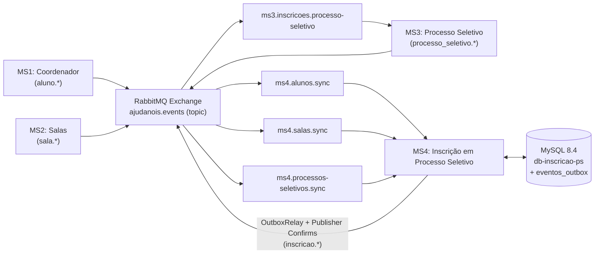

# Microsserviço 4 — Inscrição de Alunos em Processo Seletivo

Módulo Maven: [`inscricao-processo-seletivo-service/`](../inscricao-processo-seletivo-service/)

## Responsabilidade

Permitir que **alunos** consultem processos seletivos abertos (vinculados às suas respectivas **salas**), realizem ou cancelem sua inscrição e notifiquem os demais microsserviços (em especial o **Microsserviço 3**, onde o professor avalia e aceita monitores).

---

## Arquitetura & Banco de Dados

Segue o padrão **Database per Service** com MySQL 8.4 dedicado (`db-inscricao-ps`) e comunicação assíncrona via RabbitMQ (`ajudanois-rabbitmq`):



### Schema (`schema.sql`)

- `alunos` — projeção local de alunos (`id`, `nome`, `login`).
- `salas` — projeção local de salas (`id`, `nome`, `professor_id`, `professor_nome`).
- `processos_seletivos` — projeção local de processos seletivos (`id`, `sala_id`, `professor_id`, `titulo`, `status`, `max_vagas`).
- `inscricoes` — registros oficiais de inscrição (`id`, `aluno_id`, `processo_seletivo_id`, `sala_id`, `status`, `data_inscricao`) com restrição `UNIQUE (aluno_id, processo_seletivo_id)`.
- `eventos_outbox` — fila transacional de saída (`exchange_name`, `routing_key`, `payload`, `status`, `tentativas`, `ultimo_erro`).

---

## Contratos de Mensageria (RabbitMQ)

- **Exchange principal:** `ajudanois.events` (tipo `topic`, `durable = true`)
- **Dead Letter Exchange / Queue:** `ajudanois.dlx` → `ms4.dlq`

### Eventos consumidos pelo MS4 (ACK manual + `basicQos(10)`)

| Fila durável | Binding | Payload JSON esperado |
| --- | --- | --- |
| `ms4.alunos.sync` | `aluno.*` | `{"id": 1, "nome": "Ana Paula", "login": "ana.paula"}` |
| `ms4.salas.sync` | `sala.*` | `{"id": 10, "nome": "Sistemas Distribuídos", "professorId": 100, "professorNome": "Prof. Ricardo"}` |
| `ms4.processos-seletivos.sync` | `processo_seletivo.*` | `{"id": 1001, "salaId": 10, "professorId": 100, "titulo": "Monitoria FCCPD", "status": "ABERTO", "maxVagas": 2}` |

### Eventos publicados pelo MS4 (Publisher Confirms + `deliveryMode = 2`)

Fila durável pré-vinculada para o MS3: `ms3.inscricoes.processo-seletivo` (binding `inscricao.*`).

| Routing Key | Payload JSON |
| --- | --- |
| `inscricao.criada` | `{"inscricaoId": 1, "alunoId": 1, "alunoNome": "Ana Paula", "processoSeletivoId": 1001, "salaId": 10, "salaNome": "Sistemas Distribuídos", "status": "INSCRITO", "dataInscricaoIso": "..."}` |
| `inscricao.cancelada` | `{"inscricaoId": 1, "alunoId": 1, "processoSeletivoId": 1001, "salaId": 10, "canceladoEmIso": "..."}` |

---

## Modelo de Consistência e Tolerância a Falhas

1. **Consistência forte nas inscrições:** toda inscrição executa em transação ACID com `SELECT ... FOR UPDATE` na linha do processo seletivo e restrição `UNIQUE (aluno_id, processo_seletivo_id)`. Requisições concorrentes pelo mesmo aluno ou disputando as últimas vagas são serializadas e conflitos retornam erro determinístico (`INSCRICAO_DUPLICADA` / `VAGAS_ESGOTADAS`).
2. **Consistência eventual nas projeções:** dados de `alunos`, `salas` e `processos_seletivos` chegam via RabbitMQ e são aplicados por `UPSERT` idempotente.
3. **Tolerância a falhas (Transactional Outbox + ACK manual):**
   - A gravação em `inscricoes` e em `eventos_outbox` ocorre na **mesma transação SQL**.
   - Se o RabbitMQ cair durante uma inscrição, a inscrição permanece salva no MySQL e o `OutboxRelay` reprocessa os eventos `PENDENTE` automaticamente assim que o broker se recupera, usando **Publisher Confirms** antes de marcar `PUBLICADO`.
   - No consumo, mensagens malformadas vão para `ms4.dlq` e falhas transitórias são reenfileiradas (`basicNack` com `requeue`).

---

## Como executar e testar

### Testes unitários e de integração (H2 em memória)

```bash
mvn -B -pl inscricao-processo-seletivo-service -am test
```

### Execução com Docker Compose

```bash
# Subir RabbitMQ e o banco do MS4
docker compose up -d rabbitmq db-inscricao-ps

# Construir e abrir a CLI interativa do Microsserviço 4
docker compose run --rm --build inscricao-processo-seletivo
```

> Na CLI interativa, use a **opção 6** para popular dados de exemplo locais (`Alunos 1..3`, `Salas 10/20`, `Processos 1001..1003`), a **opção 8** para inspecionar/reprocessar o Outbox (ideal para demonstrar derrubando o container `ajudanois-rabbitmq`) e a **opção 9** para demonstrar consistência sob inscrições concorrentes.
